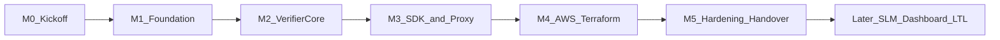
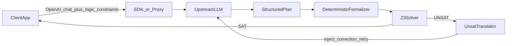

# TARKA Project Initiation Document

**Project name:** TARKA (Deterministic Logic Gateway for Agents)
**Document type:** Project Initiation Document (PID) + technical delivery plan
**Language / runtime:** Python 3.15.2 (requires-python `>=3.15`)
**Tooling:** uv (lockfile), Ruff, ty, pytest
**Proxy:** FastAPI + Uvicorn (Pydantic v2; without the optional `standard` extra to avoid a PyYAML source build on Windows Python 3.15)
**Infrastructure:** AWS ECS Fargate on Amazon Linux 2023 hosts, image `python:3.15.2-slim-trixie`, Terraform `>= 1.17.0` / AWS provider `~> 6.71`
**Product source of truth:** [C:\Users\manoj\OneDrive\Documents\Github\requirements.md](C:\Users\manoj\OneDrive\Documents\Github\requirements.md)
**Code repository:** [https://github.com/Mano-jk/TARKA](https://github.com/Mano-jk/TARKA) (Apache-2.0; currently LICENSE + README only)
**Local clone target:** [C:\Users\manoj\OneDrive\Documents\Github\TARKA](C:\Users\manoj\OneDrive\Documents\Github\TARKA)

**Executive sponsor / stakeholder:** TBD (see Open Questions)
**Target audience:** Application developers and platform teams who ship LLM agents that must obey numeric, policy, and tool-call constraints
**Target timeline:** 12 weeks for the agreed near-term delivery (Phase 1 SDK + proxy stub + AWS/Terraform baseline). Later product phases (SLM autoformalizer, dashboard, LTL) sit on a 13–20 week horizon after that, per the SRD, and are out of this PID’s build commitment.
**Budget / team:** TBD (see Open Questions). Plan assumes a small delivery team (product owner + 1–2 engineers) until numbers are confirmed.

---

## 1. Executive Summary

TARKA is an inline verification layer for LLM agents. It extracts a structured execution plan, checks it against declared business rules with the Z3 SMT solver, and either forwards a proven-valid response or injects a plain-language counterexample and retries—before the invalid plan reaches an end user.

Leadership outcome: stop mathematical and policy hallucinations from becoming production actions (wrong discounts, over-allocation, invalid tool sequences) with a measurable latency budget, not a research prototype.

This first delivery is a **Python 3.15 SDK**, a **FastAPI OpenAI-compatible HTTP proxy**, and a **repeatable AWS environment defined in Terraform 1.17**. Verification is deterministic (parsed rules + structured plan state). It does not yet include a fine-tuned autoformalizer, a developer dashboard, or multi-tenant isolation.

**Runtime rule:** use the newest *stable* releases as of 3 Nov 2026. Do not pin preview cloud runtimes (AWS Lambda `python3.15` is public preview and not SLA-backed). Fargate + official `python:3.15` images is how we run current CPython on AWS without that preview.

**Definition of success for this PID:** a developer can `uv sync` (or `uv pip install -e .`), attach `logic_constraints` to a chat call, see a 30% discount rejected against a 20% cap with a clear correction prompt, and deploy the proxy to a non-production AWS account with one Terraform apply.

---

## 2. Project Purpose and Measurable Objectives

**Business problem:** LLM tool calls and plans can violate arithmetic and policy constraints. Prompting alone is not auditable. Enterprises need a deterministic gate with a self-correction loop.

**Success looks like:** invalid plans are blocked or auto-corrected; valid plans pass with small overhead; operators can deploy and tear down AWS environments from code.

**KPIs / definition of done (this 12-week delivery):**

1. **Logic enforcement:** 100% of fixture plans that violate Phase 1 rule semantics return `UNSAT` and never pass through to the client. Golden tests include the SRD discount example (30% vs 20% cap).
2. **Self-correction:** On a seeded UNSAT then-correctable plan, the gateway retries at most twice (default) and returns a SAT response when the upstream mock supplies a legal revision.
3. **Latency (local / CI, standard rule sets, ≤100 variables):** Z3 check p95 &lt; 50 ms; proxy overhead excluding upstream LLM p95 &lt; 10 ms on a reference machine documented in README.
4. **Packaging:** `uv sync` / `uv run` works on Windows and Linux CI; `uv.lock` is committed; public API is typed; `pytest` + `ruff` + `ty` are green on `main`.
5. **Deployability:** `terraform apply` in the designated AWS account creates a reachable `/healthz` and `/v1/chat/completions` proxy in **dev**; destroy is documented and tested once.

SRD stretch KPIs (&gt;99.9% enforcement in production traffic, sub-second correction including LLM time, multi-tenant isolation) are **targets for later phases**, not this PID.

---

## 3. Scope of Work

### In scope (weeks 1–12)

- Clone and work from the TARKA GitHub repo (Git was not on PATH in the previous session; install/locate Git first).
- Python 3.15 package `tarka` managed with **uv**: rule parser, Z3 formalizer, solver, UNSAT-to-text translator, `verify()`, `Gateway` retry loop.
- FastAPI + Uvicorn OpenAI-compatible stub: `POST /v1/chat/completions`, `GET /healthz` (Pydantic v2 models for request/response).
- Deterministic rules: numeric comparisons, `AND` / `OR` / `NOT`, parentheses; bindings + proposed JSON / tool-call arguments.
- Fail policy: `fail_closed` default; `fail_open` configurable; solver timeout handled explicitly.
- Tests, SRD discount example, README (install, SDK, proxy, Terraform).
- Terraform **1.17** for **one AWS environment (dev)**: VPC, **ECS Fargate**, ALB, ECR, CloudWatch, Secrets Manager, IAM least privilege, S3 backend with native lockfile.
- GitHub Actions on `ubuntu-24.04` via `astral-sh/setup-uv`: lint, typecheck, test; image build; optional apply to dev after approval.

### Out of scope

- Fine-tuned SLM autoformalizer; free-text-to-SMT.
- Developer dashboard, Redis/Dragonfly session store, OPA/Rego.
- LTL / temporal multi-step workflows; finance/healthcare/ERP templates.
- Multi-tenant sandboxing and side-channel hardening.
- Rewriting the gateway in Rust/Go (Python is the implementation language).
- AWS Lambda managed runtime for the proxy (Lambda `python3.15` is preview; `python3.14` is older than the project runtime). Container-on-Fargate is the path that matches Python 3.15 GA.
- Production/staging AWS accounts, WAF, custom domains, and multi-region until sponsor confirms.
- Streaming chat **with** `logic_constraints` (400 with a clear error; unconstrained streaming may pass through).
- Training on customer data.

---

## 4. Phased Roadmap and Milestones

Near-term delivery uses five build phases. Two later product phases are recorded so leadership sees the SRD path without treating them as committed work.



- **M0 Kickoff (week 0):** Git clone, workspace move, confirm AWS account, Python 3.15.2 via uv, Terraform 1.17.1, sponsor/RACI. Exit: repo writable locally, questions in section 11 answered or parked.
- **M1 Foundation (weeks 1–2):** `uv init` / `pyproject.toml` (`requires-python = ">=3.15"`), `uv.lock`, Ruff + ty + pytest, `ubuntu-24.04` CI, empty Terraform 1.17 root with S3 backend placeholder. Exit: CI green on a hello-world test.
- **M2 Verifier core (weeks 2–4):** Parser, Z3 compile, unsat core, NL translator, `tarka.verify`. Exit: discount golden tests pass.
- **M3 SDK and proxy (weeks 4–7):** `Gateway` + retries; FastAPI OpenAI stub; httpx upstream; example script. Exit: mock-LLM integration test covers SAT / UNSAT / retry.
- **M4 AWS via Terraform (weeks 7–10):** Multi-stage Dockerfile (`python:3.15.2-slim-trixie` + `ghcr.io/astral-sh/uv`); Terraform modules (Fargate service, ALB, ECR); secrets in Secrets Manager; CloudWatch logs; deploy to **dev**. Exit: external `GET /healthz` 200 after apply.
- **M5 Hardening and handover (weeks 10–12):** Latency notes, acceptance checklist sign-off, README runbooks (local, AWS apply/destroy), known limitations. Exit: sponsor can run the discount demo without the implementation team.
- **Later (not committed):** Phase 2 SRD — SLM autoformalizer, dashboard (weeks 13–18 equivalent). Phase 3 SRD — LTL and domain templates (weeks 19–26 equivalent).

---

## 5. Deliverables and Acceptance Criteria

A stranger can mark each item pass/fail:

- **D1 Python SDK:** `from tarka import verify, Gateway` works. `verify({"applied_discount": 30, "max_discount_percentage": 20}, rules=["applied_discount <= max_discount_percentage"])` is UNSAT. The 20% case is SAT.
- **D2 Translator:** UNSAT message names the conflicting symbols and includes both numeric values when known.
- **D3 Retry loop:** With a mock upstream that first returns 30 then 20, the client receives a successful completion; retry count ≤ 2.
- **D4 Proxy:** Request body may include `logic_constraints`; that field is stripped before the upstream LLM; `GET /healthz` returns 200.
- **D5 Invalid plans never leak:** After max retries still UNSAT, SDK raises `LogicViolationError`; proxy returns a structured error (4xx), not the invalid assistant payload.
- **D6 Quality gate:** CI runs `uv run ruff check`, `uv run ty check`, `uv run pytest`; all must pass on `main`.
- **D7 Terraform:** From documented inputs, apply creates the proxy; outputs include URL; destroy removes the stack; no secrets in git.
- **D8 Docs:** README covers install, one SDK snippet, one curl to the proxy, and Terraform apply/destroy.

---

## 6. Roles and Decision Rights / RACI

Until named people are confirmed, roles are functional. “Ours” = delivery team working in this repo. “Theirs” = sponsor / account owner / security.

- **Product owner / sponsor (Theirs):** Approves scope changes, AWS account use, fail-open vs fail-closed default, go-live of any shared environment. **A** on scope and budget.
- **Principal engineer / implementer (Ours):** Designs Python APIs, verifier semantics, Terraform modules. **R** on D1–D8. **C** to sponsor on fail policy.
- **Security / cloud owner (Theirs):** Approves IAM, secret handling, public exposure of the proxy. **A** on AWS network posture. **C** on Terraform PRs.
- **QA (Ours, can be the same engineer):** Owns golden tests and acceptance checklist. **R** on D1–D5 evidence. **I** on infra.
- **End-user developers (Theirs):** Consume SDK/proxy. **I** until M5 demo; **C** on API shape if they exist today.

Approvals:

- Merge to `main`: passing CI; no force-push to `main`.
- Terraform apply to AWS: cloud owner **A**, engineer **R**.
- Changing rule language or public SDK: product owner **A**.

---

## 7. Assumptions, Dependencies, and Constraints

**Assumptions**

- Git for Windows (or equivalent) will be installed so `https://github.com/Mano-jk/TARKA.git` can be cloned.
- One AWS account (or at least a **dev** account) and credentials will be available before M4.
- Upstream LLM is OpenAI-compatible HTTP; API keys live in env / Secrets Manager, never in source.
- Phase 1 plans are structured JSON or tool-call arguments, not raw prose.
- Apache-2.0 remains the license.

**Dependencies**

- Z3 via current `z3-solver` wheels on CPython 3.15 (Windows + Linux CI). If a wheel lags 3.15, document WSL/Linux CI as source of truth and open an upstream pin—do not silently drop to 3.14 without a PID note.
- GitHub Actions (`ubuntu-24.04`, `astral-sh/setup-uv`).
- AWS APIs for ECS Fargate, ECR, ELBv2, CloudWatch, IAM, Secrets Manager.
- Terraform CLI **1.17.1** (constraint `>= 1.17.0, < 1.18.0`), provider `hashicorp/aws` **`~> 6.71`**.

**Constraints**

- Implementation language is **Python 3.15 only** for application code; package/env management is **uv** (not pip-only or Poetry).
- All AWS resources are declared in **Terraform 1.17** (no click-ops except the initial bootstrap of the S3 state bucket if required).
- Latency budgets in section 2 exclude upstream LLM time.
- Small team: no parallel SLM training track in this PID.

---

## 8. Risk Management Plan

1. **Git / toolchain missing on the Windows workstation** (High likelihood, Medium impact). Mitigation: install Git for Windows; verify `git` and `terraform` on PATH in M0; document exact versions in README.
2. **z3-solver wheels lag CPython 3.15 on Windows** (Medium, High). Mitigation: pin the newest compatible `z3-solver`; Ubuntu 24.04 CI is source of truth; if Windows wheels fail, document WSL with `uv python install 3.15` without dropping the 3.15 requirement.
3. **AWS account, billing, or public endpoint exposure delayed / blocked** (Medium, High). Mitigation: M2–M3 complete fully locally with Docker Compose optional; Terraform still merged as unapplied modules; no public ALB until security **A**.
4. **Rule language ambiguity vs. LLM output shape** (Medium, High). Mitigation: freeze a JSON schema for proposed state; reject unverifiable responses as fail-closed; do not silently skip verification.
5. **Latency SLOs fail once HTTP + container overhead is included** (Low–Medium, Medium). Mitigation: measure solver vs. HTTP separately; keep proxy thin; document actuals in M5 rather than hiding them.

---

## 9. Quality Standards and Governance

**Engineering standards (Python — Nov 2026 baseline)**

- CPython **3.15.2**; `requires-python = ">=3.15"`; `tarka/` package with PEP 621 [`pyproject.toml`](pyproject.toml).
- **uv** for Python install, venv, deps, and lockfile (`uv.lock` committed). Commands: `uv sync`, `uv run pytest`.
- Lint/format: **Ruff**. Types: **ty** (Astral; beta but recommended for new uv/Ruff projects). Tests: **pytest**.
- HTTP: **FastAPI** + **Pydantic v2**; HTTP client **httpx**; serve with Uvicorn. The optional FastAPI `standard` extra is omitted because it pulls PyYAML, which required a native Windows build for Python 3.15 during M1.
- Docker: official `python:3.15.2-slim-trixie`; copy `uv` from `ghcr.io/astral-sh/uv:latest`; `uv sync --frozen --no-cache`; `CMD` via `uvicorn tarka.proxy.app:app`.
- Conventional commits; semantic version starting at `0.1.0`.
- No secrets in git; `.gitignore` for `.env`, `.venv`, `.terraform/`, `*.tfstate`.
- Public functions documented; errors are typed exceptions (`LogicViolationError`, `TimeoutPolicyError`).
- Observability: FastAPI’s OpenTelemetry API dependency is available; Phase 1 emits structured JSON logs and `/healthz`. Full OTLP export is optional in M5, not a blocker.

**Infrastructure standards (Terraform / AWS — Nov 2026 baseline)**

- Terraform CLI **1.17.1**, `required_version = ">= 1.17.0, < 1.18.0"`.
- Provider `hashicorp/aws` **`~> 6.71`** (6.71.0 current; stay on 6.x).
- One root module `infra/terraform/` with `dev.tfvars`; `default_tags`: `Project=TARKA`, `Env=dev`, `ManagedBy=terraform`.
- Remote state: **S3 backend with native lockfile** (Terraform 1.10+; no DynamoDB lock table unless the cloud owner requires it).
- Compute: **ECS Fargate** (platform version LATEST) behind an ALB; image from ECR built from this repo, tagged with git SHA. **Not Lambda** for the proxy, so the runtime matches CPython 3.15 GA.
- Least-privilege task role; no long-lived keys in containers (task role + Secrets Manager). Terraform-managed secret values are also stored in state, so the remote bucket requires encryption, versioning, Block Public Access, and restricted IAM.
- `terraform fmt -check`, `validate`, and `plan` in CI; apply is manual or environment-protected.

**Governance**

- Progress = milestone exits in section 4, not status meetings.
- Weekly: CI green, open risks, whether scope crept toward SLM/dashboard.
- Acceptance: checklist in section 5 signed by product owner at M5.
- Change control: anything in “Out of scope” requires an explicit PID amendment.

**Technical architecture (implementation contract)**



Proposed tree:

```
TARKA/
  pyproject.toml
  uv.lock
  Dockerfile                # python:3.15.2-slim-trixie + uv
  .github/workflows/ci.yml  # ubuntu-24.04, astral-sh/setup-uv
  infra/terraform/          # Terraform 1.17, aws ~> 6.71, Fargate + ALB + ECR
  tarka/                    # SDK + verifier
  tarka/proxy/app.py        # FastAPI
  tests/
  examples/discount_order.py
```

Rule subset, solver SAT/UNSAT/UNKNOWN behavior, translator wording, and SDK/`verify()` API remain as previously agreed (structured plans only; default `max_retries=2`; never return an invalid plan).

**AWS shape (M4):** Private subnets with NAT egress; internal HTTPS ALB restricted to approved client CIDRs; private DNS and ACM certificate required; ECS Fargate service; environment variables from Secrets Manager (`TARKA_UPSTREAM_BASE_URL`, `TARKA_UPSTREAM_API_KEY`, `TARKA_PROXY_API_KEY`, `TARKA_FAIL_POLICY`, `TARKA_MAX_RETRIES`). The current dev baseline uses one NAT Gateway and one task; it is not highly available. Lambda + API Gateway is **out of default scope** (preview Python 3.15 / older 3.14). Revisit only if the sponsor rejects Fargate cost and accepts a 3.14 runtime split.

---

## 10. Recommended Next Steps for Kick-off

1. Approve this PID (scope, Python + Terraform, 12-week near-term, later SRD phases uncommitted).
2. Install Git, **uv**, and **Terraform 1.17.1**; clone TARKA to `C:\Users\manoj\OneDrive\Documents\Github\TARKA`; move the Cursor workspace there; `uv python install 3.15`.
3. Name sponsor, cloud owner, AWS account ID, and whether the proxy may be internet-facing in **dev**.
4. Confirm fail-closed default and OpenAI-compatible upstream.
5. Open M1: `uv` scaffold (Ruff/ty/pytest) and empty `infra/terraform` pinned to Terraform 1.17 / AWS 6.71 (no apply until account is ready).
6. Schedule a 30-minute M5 demo slot on the calendar now so handover is real.

---

## 11. Open Questions (required before the plan is fully locked)

Vital fields were placeholders. Answers do not block M1 local scaffolding, but they block M4 apply and any budget claim.

1. **Executive sponsor / stakeholder:** name and title, and who can approve AWS spend?
2. **Budget and team:** dollar cap, number of engineers, and whether a separate security reviewer exists?
3. **Hard deadline:** is 12 weeks a real external date, or an internal working window?
4. **AWS:** account ID, region, permission to create VPC/ALB/ECS, and remote-state bucket or “bootstrap it”?
5. **Dev proxy exposure:** public HTTPS vs. private-only (VPN/SSM port-forward)?
6. **Compute (default locked):** ECS Fargate + `python:3.15.2-slim`. Confirm you accept Fargate cost vs. Lambda’s older/preview Python. Until then, Fargate stays the plan.
7. **Upstream LLM:** OpenAI, Azure OpenAI, Anthropic-compatible proxy, or mock-only until keys exist?
8. **Package distribution:** GitHub + `pip install` from source only, or publish to PyPI as `tarka` (name may be taken)?
9. **Compliance:** any data-residency or “no customer prompts in logs” requirement for **dev**?

Until those are answered, defaults are: **Python 3.15.2 + uv**, **fail-closed**, **ECS Fargate**, private-if-unclear, no PyPI publish, no production account, **Terraform 1.17.1 / AWS provider ~> 6.71**.
