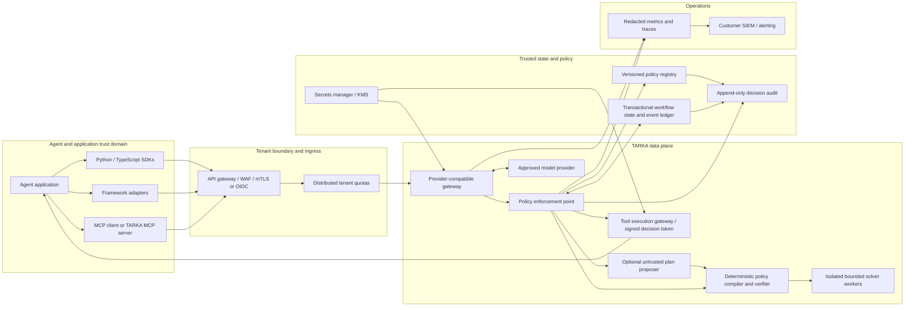

# TARKA Enterprise Architecture Plan

**Status:** Proposed target architecture and delivery plan
**Scope:** Enterprise inline verification and enforcement for agent plans and tool actions
**Baseline:** Python/Z3 verifier, FastAPI proxy, TypeScript client, framework-neutral Python `guard_tool`, and AWS Terraform dev environment
**Important:** This plan describes a target. It does not claim that production isolation, stateful workflow verification, compliance certification, or deployed SLO evidence exists today.

## 1. Architecture goals

TARKA must make it difficult for an unverified agent proposal to cause a side effect, while making verification decisions explainable, reproducible, tenant-scoped, and bounded in cost and time.

### Goals

- Enforce deterministic, versioned policies at both response and tool-execution boundaries.
- Support synchronous inline verification and durable multi-step workflow verification.
- Provide integration surfaces for model-provider proxies, SDKs, agent frameworks, and MCP tools.
- Isolate tenant identity, policy data, workflow state, solver work, credentials, and telemetry.
- Fail safely and consistently on malformed input, unsupported policy constructs, solver `UNKNOWN`, timeout, dependency failure, or unavailable trusted state.
- Make every decision traceable to the exact policy version, verifier version, input digest, and trusted workflow-state version without retaining sensitive prompts by default.
- Scale and recover without relying on process-local rate limits, metrics, or workflow history.
- Make the security boundary and limitations explicit to operators and customers.

### Non-goals

- Proving that a policy is complete, lawful, ethical, or correctly expresses business intent.
- Treating an LLM, formalizer, or natural-language explanation as a trusted verifier.
- Guaranteeing correctness of actions executed outside TARKA's mediated tool boundary.
- Storing or using customer prompts for model training by default.
- Claiming zero false-acceptance risk, a compliance certification, or production readiness before evidence and independent review.

## 2. Target architecture

Separate the **control plane** (identity, policy lifecycle, tenant administration, analytics configuration) from the **data plane** (request verification and tool enforcement). The data plane may use cached, signed policy versions during a control-plane outage only within a bounded freshness lease. Emergency revocation must invalidate caches; if policy freshness cannot be established before the lease expires, protected actions fail closed.

### Trust boundaries

1. **Untrusted caller/model input:** requests, model completions, tool arguments, schemas, policy text, and caller-supplied workflow history are untrusted.
2. **Authenticated tenant boundary:** tenant identity comes only from validated credentials or workload identity. Never trust a tenant ID in a request body or model output.
3. **Policy authority boundary:** only authorized policy publishers can create, approve, activate, or roll back immutable policy versions.
4. **Verifier boundary:** the deterministic verifier and constrained solver input are trusted code; all inputs are parsed, bounded, and validated before reaching them.
5. **Tool side-effect boundary:** a tool must check a TARKA decision at execution time. A model response that was checked earlier is not a reusable authorization.
6. **Provider boundary:** model providers are external processors. Provider selection, region, retention, and data-processing terms are tenant-configured and explicit.
7. **Operations boundary:** logs and analytics are sensitive operational records. They are minimized, tenant-scoped, access-controlled, and retained under a documented policy.

## 3. Core request and enforcement flows

### 3.1 Inline response verification

1. Authenticate the workload; derive tenant, project, and environment from trusted identity claims.
2. Enforce request size, content type, request timeout, tenant quota, and idempotency rules at ingress.
3. Resolve an immutable policy version by explicit version or tenant/project active-version pointer. Reject missing or ambiguous policy selection. Enforce the policy's freshness lease and revocation status.
4. Call the configured provider using tenant-authorized credentials and provider routing. Keep provider credentials out of SDKs and model context.
5. Extract a structured plan under a versioned response contract. Reject ambiguous, multiple, malformed, or oversized proposals.
6. If enabled, an autoformalizer may propose a structured representation. Treat it as untrusted: validate against a safe intermediate language and the selected policy; never execute generated SMT-LIB or arbitrary code.
7. Compile deterministic rules and schema into bounded solver input. Run in an isolated worker with CPU, memory, wall-clock, recursion, and input-size limits.
8. Apply the decision contract:
   - `SAT`: the plan satisfies the selected, active policy for the supplied trusted facts.
   - `UNSAT`: do not release an actionable response; return a redacted diagnostic or use bounded correction retries.
   - `UNKNOWN`, timeout, invalid policy, unavailable state, or internal error: fail closed for protected actions.
9. Record the decision metadata and audit event. Do not retain prompts or raw tool arguments by default.
10. Return the original structured response only after the gate succeeds. Correction feedback is derived from approved, redacted policy diagnostics, not raw solver internals.

### 3.2 Tool execution and workflow verification

Inline response checks alone do not prevent an agent from bypassing the proxy or replaying an old result. Enterprise integrations must put an execution-time policy enforcement point (PEP) immediately before each protected side effect.

1. The agent submits a tool intent, arguments, workflow/session ID, and idempotency key to the TARKA tool gate.
2. The gate authenticates the workload and derives tenant/project identity; validates the tool name, argument schema, policy version, and workflow version.
3. It reads trusted prior outcomes from the workflow ledger. Caller-supplied history is never authoritative.
4. It evaluates preconditions, authorization, temporal/DAG constraints, resource limits, and tool-specific rules.
5. On approval, issue a short-lived, single-use decision token bound to tenant, workflow version, policy version, tool, normalized argument digest, expiry, and nonce.
6. The execution adapter verifies and consumes the token while invoking the tool. A replay, changed argument, changed policy, expired token, or stale workflow version is rejected.
7. Persist the tool outcome with a conditional workflow-version update and idempotency record. Retries must not duplicate side effects.
8. If the external tool succeeds but the outcome write fails, mark the workflow as outcome-unknown and require reconciliation. Do not infer success or automatically replay a non-idempotent action.

The tool gate can execute the tool itself or issue a decision token to a trusted adapter. The first production integration should use a TARKA-controlled execution adapter for the highest-risk tools because it gives the strongest enforcement boundary.

## 4. Component responsibilities and contracts

### Data plane

- **Edge/API gateway:** TLS, WAF rules, mTLS/OIDC validation, abuse controls, distributed quotas, request IDs, routing, and coarse rate limits.
- **Provider gateway:** OpenAI-compatible and Anthropic-compatible adapters; normalize only supported semantics; explicit capability negotiation; no silent dropping of provider options or content blocks.
- **Policy enforcement point:** orchestrates policy resolution, verification, workflow-state checks, retry policy, decision generation, and audit recording.
- **Policy compiler:** compiles reviewed policy formats into a versioned, deterministic intermediate representation (IR). Reject unknown or unsupported constructs.
- **Verifier:** pure, deterministic evaluation of the IR against a structured proposal and trusted facts. Return typed `SAT`, `UNSAT`, `UNKNOWN`, or `ERROR` results.
- **Solver workers:** separate process/container boundary; non-root; no network access; read-only filesystem where practical; strict resource limits; bounded input/output IPC; worker recycling and health checks.
- **Tool gate/adapters:** enforcement at action time, schema/rule checks, idempotency, short-lived decision binding, and outcome recording.
- **Optional autoformalizer:** converts policy-authorized inputs into a candidate IR only. It must not publish or activate policies, bypass deterministic checks, or call tools.

### Control plane

- **Identity and tenancy:** organization, project, environment, workload identity, roles, service accounts, key rotation, and tenant lifecycle.
- **Policy registry:** draft, validate, review, approve, activate, rollback, deprecate, and archive immutable policy versions; retain provenance and approvals.
- **Policy distribution:** distribute signed policy artifacts with version, tenant scope, activation time, expiry/freshness lease, and revocation status; enforce bounded cache staleness in the data plane.
- **Policy test harness:** golden cases, property-based tests, mutation tests, adversarial fixtures, and compatibility checks before activation.
- **Administration API/UI:** role-scoped configuration, policy diff/review, deployment promotion, quota settings, provider configuration, and audit search.
- **Analytics/export:** bounded aggregate metrics and customer-controlled audit export; no default storage of prompts or raw arguments.

### Stable internal contracts

Every decision record should include:

- `decision_id`, `request_id`, `tenant_id`, `project_id`, and optional `workflow_id`.
- Policy ID and immutable version/digest; verifier/compiler build digest.
- Decision status and a stable, machine-readable reason code.
- Normalized plan/tool-argument digest, not raw content by default.
- Workflow version before and after the decision where applicable.
- Solver duration, overall duration, retry count, and bounded resource-use counters.
- Correlation trace ID and authenticated workload identity.

Public API contracts should be versioned. Policy activation and tool-execution endpoints require idempotency keys and optimistic concurrency/version preconditions. Decisions are not bearer authorization unless they use the single-use token contract above.

## 5. Policy model and semantics

- Define a versioned TARKA IR for variables, types, units, facts, predicates, action preconditions/postconditions, invariants, and workflow transitions.
- Keep policy authoring separate from policy execution. A policy is immutable once published; changes create a new version.
- Support JSON Schema and OpenAPI subsets through explicit capability profiles. Publish unsupported-keyword matrices and reject unsupported semantics rather than approximating.
- Add OPA/Rego as a policy source only through a reviewed adapter with explicit semantics. Do not assume arbitrary Rego maps soundly to SMT. Keep authorization decisions distinct from mathematical invariants.
- Add DAG/LTL/state-machine functionality against server-owned workflow state, versioned and transactionally updated. Document finite-trace semantics, event ordering, unknown outcomes, compensation, and clock behavior.
- Establish numeric semantics: units, currency precision, rounding modes, overflow, integer versus real arithmetic, null/missing values, and floating-point handling. Normalize money to fixed-scale decimal/integer units before solver compilation.
- Treat solver `UNKNOWN` as a first-class decision. Never equate it with `SAT`.
- Unsat explanations must be deterministic and policy-approved. Do not expose confidential rules, tenant data, solver internals, or other tenants' values in retry prompts or API errors.
- A `SAT` decision proves only that the encoded input satisfies the selected policy. It does not certify external facts, policy completeness, provider truthfulness, or downstream execution.

## 6. Enterprise security and privacy baseline

### Identity and tenant isolation

- OIDC/OAuth2 workload identity and mTLS for service-to-service traffic; short-lived credentials preferred. API keys are transitional and must be hashed/rotated, tenant-bound, scoped, and revocable.
- Enforce RBAC/ABAC on policy publication, activation, audit access, and administration. Require separation of duties for production policy approval.
- Resolve tenant from verified identity claims; enforce tenant filters at every API, DB, cache, queue, object-store, metrics, and audit access.
- Use tenant-scoped encryption context/keys where contractual risk justifies it. Never rely on tenant IDs as the sole isolation mechanism.
- Separate dev, staging, and production accounts/projects, secrets, data, and signing keys.

### Data protection

- Default to no prompt, completion, policy text, or raw argument retention in logs/metrics/traces.
- Use allow-listed structured telemetry, secret/PII redaction, payload-size caps, and configurable short retention for approved audit data.
- Encrypt in transit and at rest with managed KMS keys; document region, residency, provider processing, retention, deletion, and backup behavior.
- Do not use tenant data for training by default. Any evaluation/training opt-in requires explicit contractual approval, redaction, dataset lineage, retention limits, and an opt-out/deletion process.
- Provide tenant export/deletion workflows while preserving legally required immutable audit evidence under an agreed retention policy.

### Abuse and resource controls

- Distributed quotas and concurrency limits per organization, project, model/provider, and workflow; backpressure and overload responses.
- Per-request limits for body size, schema size/depth, policy complexity, solver time/memory, retries, tool count, workflow length, and response size.
- Egress allow-list or controlled egress proxy; deny arbitrary network access from solver workers.
- Protect against SSRF, parser bombs, decompression bombs, regex/pathological-schema costs, solver denial of service, token abuse, replay, and cross-tenant cache-key collisions.
- Run signed images, non-root containers, minimal base images, SBOM, dependency and image scanning, provenance/attestation, and controlled promotion between environments.
- Apply security headers and CSRF protections to administration UI; separate public API authentication from dashboard/admin authorization.

### Governance and assurance

- Maintain threat model, data-flow inventory, security architecture review, privacy impact assessment, incident response plan, vulnerability disclosure process, and service-specific runbooks.
- Map controls to customer-required frameworks (for example SOC 2 or ISO 27001) only after evidence exists; do not imply certification from architecture alone.
- Require independent penetration testing and tenant-isolation review before production multi-tenancy.
- Establish policy change review, approvals, rollback, emergency disable, evidence retention, and customer notification processes.

## 7. Reliability, operations, and deployment

### Reference AWS deployment

Use the current Terraform/Fargate footprint only as a **dev baseline**. Production should be a separate, reviewed module/profile with:

- Multi-AZ ingress and stateless gateway tasks with autoscaling, deployment health checks, and graceful draining.
- WAF/API gateway and distributed quotas; private networking where possible; controlled egress for approved model endpoints.
- Separate gateway, policy/control plane, workflow store, solver workers, and telemetry permissions and scaling policies.
- Managed relational storage for policy metadata and approvals; a transactional, tenant-keyed workflow/event store with conditional version writes and retention controls. Select one authoritative store per record type; avoid dual-write consistency.
- Multi-AZ database, point-in-time recovery, encrypted backups, restore drills, and a documented cross-region recovery strategy if required.
- Secrets Manager/KMS, private ECR, CloudWatch/OTel export, customer SIEM integration, alarms, and deployment approvals.
- Infrastructure policy checks, drift detection, protected Terraform state, plan review, least-privilege deploy roles, and no production apply from developer credentials.
- Per-environment service quotas, capacity budgets, autoscaling bounds, and cost alerts.

### Reliability behavior

- Keep synchronous verification in the request path; use asynchronous jobs only for explicitly asynchronous workflows, bulk policy tests, and analytics.
- Apply bounded timeouts to provider calls, verification, state reads/writes, and audit persistence. A protected action is not approved if required state or durable decision recording is unavailable.
- Use retries only for safe/idempotent operations with exponential backoff and jitter; enforce an end-to-end deadline and maximum retry budget.
- Use circuit breakers and bulkheads per provider and tenant. Provider outage must not starve solver or control-plane capacity.
- Support graceful degradation only for non-enforcement features (dashboard, analytics, optional formalizer); never degrade protected verification into an allow.
- Maintain tested rollback for binaries and policy versions. Data migrations must be backward-compatible across rolling deploys.
- Define and exercise recovery point/time objectives with the service owner before production. Suggested initial objectives for review: RPO <= 5 minutes and RTO <= 1 hour for control/workflow state.

### Observability and SLOs

Proposed initial targets are planning values; confirm with product and customer owners before commitment:

| Measure | Initial target | Measurement boundary |
|---|---:|---|
| Data-plane availability | 99.95% monthly | Authenticated verification requests; exclude upstream provider availability and approved maintenance |
| Deterministic verification p95 | <= 50 ms | Standard bounded policy set, excluding model/provider calls |
| Gateway overhead p95 | <= 10 ms | Proxy/API overhead excluding provider and solver time; publish solver separately |
| Protected-action decision completeness | 100% fail-closed on missing/unknown/error states | Fault injection and integration tests; not a claim that policy is complete |
| Enforcement test corpus | 100% expected decisions | Versioned golden/adversarial corpus per supported policy profile |
| Audit decision durability | No acknowledged protected action without durable decision record | Integration and failure-injection tests |

Use OpenTelemetry traces with payload capture disabled, low-cardinality metrics, and structured reason codes. Alert on error/timeout rate, solver `UNKNOWN`, queue/resource saturation, provider failures, stale policy cache, workflow conflicts, audit write failures, quota abuse, and SLO burn. Provide per-tenant views with strict authorization and aggregation thresholds.

## 8. Integration strategy

Provide a small stable core protocol and thin adapters, not one custom policy engine per framework:

1. **REST API and Python/TypeScript SDKs:** reference integration and versioned request/decision types.
2. **OpenAI-compatible and Anthropic-compatible proxy:** provider routing and response verification, with documented supported subsets and no false compatibility claim.
3. **Tool-execution adapter:** an execution-time guard API and SDK wrapper for Python/TypeScript; add Java/.NET/Go clients as customer demand requires.
4. **MCP:** TARKA MCP server exposing verified policy/workflow tools and/or client-side middleware; tool execution must pass through the PEP, not merely a prompt instruction.
5. **Framework adapters:** LangChain/LangGraph, Semantic Kernel, CrewAI, and other frameworks as thin wrappers around the same decision and tool-gate contract.
6. **Enterprise policy inputs:** JSON Schema/OpenAPI subset, TARKA DSL/IR, and a separately scoped OPA/Rego adapter after semantics and security review.

Every adapter must preserve tenant identity, policy version, request/idempotency IDs, cancellation/deadlines, and error semantics. An adapter may not convert `UNKNOWN`, timeout, or validation errors into success.

## 9. Go-to-market strategy

### Current launch decision

**Status: not ready for public launch or production enforcement. Ready to begin customer discovery and carefully scoped, non-production design-partner evaluation.** The current repository is a narrow prototype: it does not provide the remote execution-time tool gate, trusted server-side workflow state, durable audit, production tenant isolation, or deployed operational evidence described in this plan. A local `guard_tool` is not a production enforcement boundary, and configurable fail-open behavior must not be used to protect a live side effect.

Until the production release gate in section 11 is met:

- Demonstrations must use synthetic data and mocked or non-side-effecting tools. Do not connect a prototype to customer production credentials, live payment/order/refund systems, or unsupervised production actions.
- A design-partner evaluation may use customer data only after the data-processing terms, access controls, retention/deletion, and approved environment are agreed in writing. Prefer redacted or synthetic data.
- A paid pilot, if offered, must be explicitly non-production, time-bounded, narrow in scope, and contractually clear that the current evaluation does not authorize or protect production side effects. Do not describe a shadow decision as enforcement.
- Do not advertise production availability, a service-level commitment, compliance certification, complete provider compatibility, or a supported deployment option until its evidence and owner exist.

The acceptance ledger is the source of truth for shipped capability. A change to that ledger, new customer interest, or a successful demo alone does not clear a production gate.

### Initial market and positioning

- **Beachhead ICP hypothesis:** B2B software companies with an agent already calling business APIs in a bounded workflow, an engineering team able to integrate a guard, a policy owner able to state rules and provide authoritative facts, and a material cost to manual review or incorrect actions. Treat this as a hypothesis to validate, not an established market segment. Defer highly regulated or irreversible production workflows until the required assurance and recovery evidence exists.
- **Choose the first workflow empirically:** compare candidate workflows on repeated demand across accounts, clarity/testability of rules, trustworthy facts, harm and reversibility, ability to mediate every relevant side effect, integration effort, buyer ownership, and willingness to pay. Prefer a bounded, reversible or reconcilable action. Discount/refund/purchase examples are candidates, not a preselected vertical; do not start with the highest-consequence case merely because it is easy to demo.
- **Buyer and champion hypothesis:** the AI/platform engineering leader may own runtime and budget; an agent engineer may champion integration. Identify the actual budget owner and procurement path in discovery. Security, legal/privacy, finance/operations, and procurement may be approval stakeholders, not assumed buyers.
- **Positioning hypothesis:** “TARKA checks structured agent proposals against explicit rules and, when integrated at the execution boundary, can gate mediated tool actions.” Test this language against actual alternatives. Differentiate on deterministic, testable policy decisions—not prompt filtering or an LLM judge. Position TARKA as a complement to identity, authorization, business systems, human approval, and monitoring, not a replacement.
- **Alternatives to assess:** in-house checks, existing authorization/business-rule engines, workflow orchestration, human review, model-provider guardrails, and doing nothing. Record why a prospect would adopt, build, defer, or reject TARKA. Do not claim category leadership, uniqueness, or quantified savings without comparative evidence.
- **Claim boundary:** a pass means only that the encoded proposal satisfied the selected rules for the supplied facts. Do not claim that TARKA proves facts, policy completeness, model truthfulness, overall agent safety, regulatory compliance, or protection of tools that bypass the gate.

Select the initial workflow with a written scorecard, not the loudest prospect request. For each candidate, record evidence for: repeated demand across accounts; rule clarity and testability; authority and freshness of input facts; consequence, reversibility, and recovery; whether all relevant side effects can be mediated; integration and support effort; an accountable buyer/policy owner; and a concrete willingness-to-pay signal. Reject a workflow if its critical facts cannot be trusted or a side-effect path cannot be controlled, regardless of its total score.

### Offer and sales motion

1. **Discover:** interview the workflow operator, technical owner, policy owner, and budget/procurement owner where possible. Ask about a recent concrete failure or exception, existing controls and workarounds, frequency and impact, source/authority of facts, bypass paths, alternatives, and buying process. Avoid leading with a proposed solution; capture disconfirming evidence as carefully as positive feedback. Ask for examples and artifacts (redacted if needed), not just opinions or hypothetical purchase intent.
2. **Qualify:** proceed only when there is a specific repeated workflow, an accountable policy owner, representative cases and authoritative facts, a feasible mediation point, a technical champion, a path to budget/procurement, and explicit acceptance of current limitations. Disqualify workflows requiring arbitrary natural-language judgment, unsupported policy constructs, caller-invented trusted history, or actions that can bypass the proposed gate.
3. **Evaluate:** use a reproducible demo with synthetic data, then customer-approved redacted cases in an approved non-production environment. Agree on the evaluation corpus and expected outcomes before running it. Shadow mode is observational only; a human or existing control remains authoritative.
4. **Pilot:** use a written statement of work specifying one workflow, environment, integration, policy set, scope exclusions, data handling, named owners, time box, success/stop criteria, support boundaries, price, and a conversion decision date. The initial pilot validates decision quality and integration economics, not live enforcement. Production side effects remain prohibited until the execution-time gate, trusted state, durable audit, and section 11 release evidence are actually delivered.
5. **Convert:** sell a narrow production deployment only after its release gates pass and the customer approves the exact action class, policies, deployment, fallback/human escalation, and operating limits. Use a staged rollout with an immediate disable/rollback path. Expansion requires evidence from safe operation and repeatable onboarding.
6. **Distribute:** begin with founder-led technical selling and direct design partners. Add self-serve docs or community content when they reduce observed onboarding friction. Consider partners, marketplaces, or paid acquisition only after a repeatable conversion path and support model are demonstrated.

Use a consistent discovery guide:

- “Walk me through the last time an agent proposed or performed an action that needed correction, review, or escalation.”
- “What happened, how often does this occur, and what is the operational or business consequence? How do you handle it now?”
- “Which facts and policies determine whether the action is allowed? Who owns them, and where do the trusted facts come from?”
- “What other route could execute the same action, and what prevents the agent or operator from bypassing this check?”
- “What would security, legal/procurement, and the budget owner need to approve an evaluation? What is the next concrete step and who owns it?”
- “What would make you reject this approach or keep the current process? If the evaluation meets agreed criteria, what approval and budget decision follows?”

Do not count an interview as validation merely because the prospect likes the concept. Record account and participant role, workflow, specific evidence, current alternative, consequences, data/control boundary, buying process, objections, next committed action, and confidence. Avoid collecting sensitive customer data in prospecting notes.

### Packaging and pricing hypothesis

- **Pilot offer:** fixed scope and term; one workflow and adapter; agreed case corpus; integration/evaluation support; explicit out-of-scope production enforcement; documented deliverables and conversion review. Quote only after estimating implementation, infrastructure, and support effort. If an evaluation is free, require the same customer commitments and decision date as a paid pilot, and limit the number of free engagements.
- **Production packaging hypothesis:** annual platform fee with a clearly defined deployment/support tier and included verified-decision volume; price additional volume or environments only if cost and value correlate with that metric. Keep model-provider spend separate because TARKA does not control it. Validate the billing unit against customer procurement expectations and avoid incentives that discourage safe checks.
- Do not publish a price card or promise private deployment, shared SaaS, or service levels before they are supported. Test willingness to pay through concrete scoped proposals and procurement action, not hypothetical interview answers. Record quoted price, discount, decision owner, objections, win/loss, delivery cost, and support effort.

### Validation method and launch gates

The numerical thresholds below are initial decision rules for a small team, not statistically representative market research or evidence of product-market fit. Set a review date and adjust only with recorded evidence; do not lower a safety gate to meet a calendar date.

| Gate | Evidence required to proceed |
|---|---|
| Problem validation | Complete 12 structured interviews across at least 8 target accounts. At least 5 accounts independently describe the same costly, bounded workflow and identify a plausible owner and buying path. If not, revise ICP/use case and repeat discovery before broad build-out. |
| Design-partner fit | At least 3 qualified partners agree to evaluation terms, name a policy owner and technical champion, provide cases, accept limitations, and commit to feedback. At least 2 share the same workflow. |
| Paid-pilot signal | At least 1 partner signs a paid non-production pilot or provides a procurement-backed commitment before investment in broad integrations or shared multi-tenancy. |
| Evaluation proof | Customer and TARKA agree on case corpus and adjudication before testing. Report false accepts/rejects with numerator, denominator, case provenance, and severity; any high-consequence false accept blocks progression until root-caused and retested. Document latency, cost, setup effort, unsupported cases, and limitations. A finite corpus does not establish a general safety rate. |
| Production readiness | All production release gates in section 11 pass for the exact deployment and action scope; the specific execution boundary is tested end-to-end. |
| Repeatability | At least 2 customers complete the same bounded onboarding without customer-specific product forks; measured implementation/support/infrastructure costs and observed retention or expansion intent support the offer before scaling acquisition. |

Use one funnel with stage definitions: target account → qualified problem → technical evaluation → pilot proposal → signed pilot → successful pilot → production approval → renewal/expansion. Report counts, conversion, time in stage, loss reason, and cohort. Track time-to-first-valid-policy, integration/maintenance hours, adjudicated decision errors, decision latency/cost, safe blocks/escalations, availability, support burden, gross margin, and renewal. Do not use page views, demo count, solver `SAT` rate, or unqualified letters of intent as substitutes for buyer commitment or product proof.

### Launch assets and operating readiness

Before actively soliciting pilots, prepare and review:

- A reproducible synthetic demo, quickstart, supported-feature/unsupported-feature matrix, architecture and data-flow diagram, and clear setup/teardown instructions.
- A one-page product description, target workflow, limitations, and evaluation offer; technical documentation must distinguish response checking, local tool guards, and production execution-time enforcement.
- A security questionnaire pack containing only verified facts: data collected/retained, authentication, deployment boundary, subprocessors/providers, encryption, vulnerability reporting, incident contact, and known gaps. Never label planned controls as implemented.
- Pilot SOW and data-processing terms reviewed by appropriate legal/privacy owners; specify ownership of policy, test data, decision outputs, retention/deletion, incident notification, and termination.
- A support and escalation path, issue triage owner, severity definitions, rollback/disable procedure, and a customer communication plan for evaluation failures.
- A sales evidence log and product feedback loop linking each requested feature to the account, use case, buying stage, and whether it is blocking a committed pilot.

Do not announce a general availability date until the production gate is satisfied. A public launch should have a named owner for every customer-facing commitment and a tested route to handle security reports, incidents, support requests, and product limitations.

### Readiness decision

Based on evidence in this repository only; an accountable owner must verify any external evidence before changing status:

| Motion | Status | Basis / condition |
|---|---|---|
| Customer discovery | **GO** | Can proceed with the interview guide and hypotheses above; no product-readiness claim is needed. |
| Synthetic demonstration | **CONDITIONAL GO** | Use a repeatable local or controlled demo, synthetic inputs, and mocked/non-side-effecting tools. External container/deployment verification remains pending in the acceptance ledger. |
| Customer-data evaluation | **NOT YET VERIFIED** | Proceed only after an approved environment, written data terms, access/retention controls, and a named technical/support owner are verified. |
| Production side effects / public general availability | **NO-GO** | Execution-time remote enforcement, trusted server-owned workflow state, durable audit, production isolation, deployment/DR evidence, independent security review, and operations evidence are not established in the current repository. |

This is a stage-gated plan ready to execute for discovery, not evidence that TARKA or its team is ready to sell or operate a production service. Change a status only when the corresponding evidence is recorded, reviewed, and owned; do not treat the plan's existence as passing a gate.

### Explicit depriorities and stop conditions

- Do not lead with a generic “AI safety platform,” every agent framework, a fine-tuned formalizer, broad policy-language compatibility, or compliance certification.
- Do not build shared multi-tenancy, a large adapter catalog, or a full analytics/control-plane suite before repeated buyer evidence warrants them.
- Pause or change the beachhead if interviews do not reveal a common bounded workflow with an accountable policy owner, if customers will not pay for the control, if onboarding requires bespoke policy engineering every time, or if the required enforcement boundary cannot be made operationally trustworthy.
- If buyers primarily need authorization, identity, human approval, or observability rather than deterministic invariant checks, integrate with those systems or reconsider the product wedge instead of claiming to replace them.
- Stop a pilot immediately if the customer expects unsupported enforcement, cannot identify authoritative facts or policy ownership, finds an unmediated path to the protected side effect, or encounters a high-consequence false accept that is not understood and resolved.

## 10. Delivery roadmap and exit criteria

Sequence investment against the commercial gates above. The 90-day outline is a planning cadence from approval to start, not a delivery or revenue promise. Assign a named individual to each accountable role before execution. If a gate fails, pause the next phase and revise or stop rather than continuing on sunk-cost logic.

| Window | Accountable role | Work and evidence | Gate |
|---|---|---|---|
| Weeks 1–2 | Founder/product lead | Build a target-account list; prepare interview guide, workflow scorecard, hypothesis log, and synthetic demo; conduct first discovery interviews. | Confirm access to the relevant operators and buyers; revise interview sampling if not. |
| Weeks 3–5 | Founder/product lead | Complete initial interview cohort; document competing approaches, repeated problem evidence, buyer/procurement path, use-case ranking, and disconfirming evidence. | Meet problem-validation threshold or change the beachhead before feature expansion. |
| Weeks 6–8 | Product lead with technical lead | Recruit design partners; agree evaluation scope, test corpus, data boundary, success/stop criteria, and written pilot proposal. | Meet design-partner fit and secure a paid-pilot/procurement signal before substantial product investment. |
| Weeks 9–13 | Technical lead and security/operations owner | Run only the approved non-production pilot; measure correctness, false accepts/rejects, performance, integration/support cost, and willingness to convert. Produce a go/no-go review. | Continue into production-enforcement work only with a passing evaluation and commercial commitment; production remains blocked by section 11. |

### Stage 0 — Validate the problem before broad build-out

- Run the discovery interviews and test the beachhead, first workflow, buyer, deployment/procurement constraints, and pricing hypothesis.
- Select one initial action class, source of trusted facts, policy owner, and customer-observable success measure.
- Decide the pilot data-handling agreement, deployment boundary, support owner, and explicit non-production versus production scope.
- **Exit:** section 9 problem-validation threshold is met; otherwise revise the ICP/use case before adding platform scope.

### Stage 1 — Design-partner evaluation

- Freeze the narrow request/decision contract and supported policy/schema subset for the selected workflow.
- Make the current single-tenant prototype straightforward to evaluate; add repeatable fixtures, policy test corpus, decision explanations, and setup/rollback documentation.
- Use only synthetic or customer-approved redacted inputs. Shadow evaluation is observational and cannot authorize actions.
- **Exit:** section 9 design-partner fit and paid-pilot signal are met; results against an agreed, adjudicated corpus, integration effort, and buyer objections are documented.

### Stage 2 — Paid pilot and production-enforcement foundation

- Build server-owned workflow state, tool gate, argument-bound single-use decisions, idempotency, outcome reconciliation, durable audit, and explicit authorization semantics for the chosen action.
- Establish isolated deployment, identity, policy approval/rollback, data retention, support, incident response, and resource limits for that pilot. Keep a single-tenant deployment; do not expose shared multi-tenancy as a shortcut.
- Prove failure behavior, bypass resistance, replay/race handling, audit availability, and customer acceptance with the actual adapter and side effect.
- **Exit:** the paid pilot's written success criteria pass, release gates in section 11 pass for its deployment profile, and the customer explicitly approves the narrow production scope. Otherwise remain non-production or stop.

### Stage 3 — Repeatable launch

- Productize only the onboarding and adapter paths repeated by pilot customers. Add production operations, support/on-call, SLO measurement, restore/rollback drills, and customer security evidence.
- Prefer single-tenant or customer-isolated deployments until customer demand, operational evidence, and an independent isolation review justify a shared multi-tenant service.
- **Exit:** two customers complete repeatable onboarding without product forks; costs, margins, reliability, support load, and renewal intent support the proposed packaging.

### Stage 4 — Evidence-led expansion

- Add another action domain, deployment model, policy profile, framework, or MCP integration only when multiple qualified customers request it and the same conformance and security gates can be met.
- Consider shared multi-tenancy, broader JSON Schema/OpenAPI, OPA/Rego, general DAG/LTL, autoformalization, and analytics as separate investment decisions, each with a named buyer problem and measurable acceptance criteria.
- **Exit:** each expansion has a documented customer case, compatibility/security review, operational cost estimate, and a test corpus before release.

## 11. Verification and release gates

### Test strategy

- Unit and property-based tests for parsing, type/unit semantics, determinism, solver result mapping, and diagnostic redaction.
- Differential/conformance tests for every supported schema, OpenAPI, provider, and policy profile.
- Golden policies with SAT/UNSAT/UNKNOWN cases, boundary values, null/missing values, rounding, overflow, and ambiguous inputs.
- Security tests for cross-tenant access, auth confusion, SSRF, replay, cache poisoning, parser/resource exhaustion, secret leakage, and policy downgrade.
- Concurrency and failure tests for stale policy versions, workflow races, duplicate tool calls, partial failures, solver termination, audit-store outage, and provider timeout.
- Load/soak tests for p50/p95/p99 latency, tenant fairness, max concurrency, autoscaling, and cost at representative rule sizes.
- End-to-end tests that demonstrate the actual protected side effect cannot occur without the tool gate.

### Production release gate

No production launch until all are true:

- Named service owner, on-call rotation, support path, customer data classification, and escalation process.
- Threat model and independent security/tenant-isolation review findings resolved or formally accepted.
- SLOs and RPO/RTO approved; load, fault-injection, backup restore, and rollback evidence recorded.
- Policy approval/rollback, audit export, key rotation, tenant deletion, and incident-response procedures exercised.
- Provider data-processing terms, region, retention, and credential ownership approved.
- No unresolved critical/high security findings; SBOM and image provenance retained.
- Customer-facing limitations clearly distinguish policy conformance from truth, safety, and policy completeness.

## 12. Decisions to lock before a production pilot

Use these recommended defaults to avoid an open-ended architecture effort; record exceptions with the design partner and service owner:

1. **Deployment:** one isolated single-tenant environment chosen to satisfy the first pilot's procurement needs; do not offer both private and shared SaaS until supported.
2. **Identity:** verified workload identity; tenant/project derived from authenticated claims; narrowly scoped short-lived credentials. Any API-key transition must be explicitly time-limited and revocable.
3. **Scope:** one action class, one supported adapter, and one authoritative source of policy facts; no arbitrary tools or untrusted caller-supplied workflow history.
4. **Policy authority:** a named customer policy owner, approval roles, emergency disable/rollback procedure, and agreed audit retention.
5. **Execution semantics:** server-owned workflow identity/version, event ordering, idempotency, and a reconciliation path for ambiguous external outcomes.
6. **Data processing:** provider allow-list, region, retention, deletion, backup, and customer key requirements approved before customer data is used.
7. **Compatibility:** publish the exact schema/provider subset used by the pilot; reject unsupported constructs rather than approximating.
8. **Service limits:** measure latency, throughput, policy/solver limits, recovery objectives, and cost in the pilot; publish commitments only after evidence and owner approval.
9. **Integration priority:** support only the pilot's agent/framework/MCP path until another path is demanded by qualified buyers.
10. **Autoformalizer:** out of initial release scope unless a validated buyer need outweighs its added evaluation, privacy, and operational risk.

## 13. Current baseline versus target

The current repository is a useful deterministic prototype, not yet the enterprise target:

- **Implemented:** Python/Z3 rules, response retries, constrained proxy routes, bounded schema construction, limited OpenAPI import, finite caller-supplied workflow guard, Python `guard_tool`, TypeScript client, aggregate in-memory metrics, process-local tenant quotas, request limits, and dev Terraform.
- **Not yet enterprise-grade:** trusted server-side workflow history, execution-time remote tool gate/tokens, durable policy lifecycle/audit, distributed quotas, solver process isolation, durable tenant state/metrics, broad provider/framework support, multi-AZ production deployment, external security review, and deployed SLO/DR evidence.
- **Deployment constraint:** current Terraform is a dev baseline. Task egress now requires approved CIDRs; the deployment has not been applied to AWS.
- **Critical semantic caveat:** response verification does not protect actions executed outside TARKA's tool gate. Caller-supplied history is not trusted state.

The [acceptance ledger](./ACCEPTANCE.md) remains the status source for shipped and pending work. This document is the target architecture and sequencing plan, not a declaration that its phases have been delivered.
